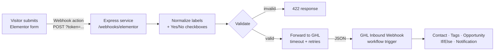

# GHL Website Lead Automation

A small Node.js service that receives **Elementor Pro / WordPress form webhooks**, cleans up the data, validates it and forwards it to a **GoHighLevel (GHL) inbound webhook** with retries and a timeout.

It solves two common problems:

- With *Advanced Data* turned off, Elementor sends **field labels as keys** (`"Email Address"`, `"Website URL"`), and unlabeled fields arrive as `"No label field f00d123"`. This service maps them to stable keys (`email`, `website`, `wants_short_call`).
- Checkboxes arrive as `on` or are missing completely. The service turns them into clear `Yes` / `No` values that GHL If/Else conditions can use.

> Built by [Meraz.Pro](https://meraz.pro) as a portfolio demo. No real webhook URLs or client data are included.

## Architecture



The GHL side is described step by step in [docs/ghl-workflow.md](docs/ghl-workflow.md).

## Features

- Supports both Elementor payload shapes (Advanced Data on and off)
- Label aliases (`Full Name` → `name`, `Email Address` → `email`, ...) and an optional `FIELD_MAP` for unlabeled fields
- Name splitting into `first_name` / `last_name`, lowercase emails, control-character stripping and length limits
- Validation (email or phone required, plus email, phone and URL format checks)
- Shared-secret check via `?token=` (Elementor can't send custom headers), with timing-safe comparison
- Forwarding with a per-attempt timeout and exponential backoff on network errors, 429 and 5xx (no retries on other 4xx)
- Does not log lead contents or the webhook URL
- Vitest + Supertest tests with mocked `fetch`

## Project structure

```
src/
  app.js         Express app and route
  config.js      Environment configuration
  normalize.js   Elementor payload normalization
  validate.js    Lead validation
  forwarder.js   GHL forwarding with timeout and retries
  server.js      Entry point
test/            Vitest tests (fetch is mocked)
docs/            GHL workflow guide
examples/        Sample Elementor payload
```

## Setup

Requirements: Node.js 18+.

```bash
npm install
cp .env.example .env    # then fill in GHL_WEBHOOK_URL and WEBHOOK_SECRET
npm run start:env       # Node 20.6+ (loads .env)
# or, on Node 18: export the variables yourself, then run: npm start
```

| Variable | Description |
| --- | --- |
| `GHL_WEBHOOK_URL` | Your GHL workflow's inbound webhook URL (keep it secret) |
| `WEBHOOK_SECRET` | Long random string, passed by Elementor as `?token=` |
| `FIELD_MAP` | JSON map of raw labels to clean keys, such as `{"No label field abc1234":"wants_short_call"}` |
| `BOOLEAN_FIELDS` | Comma-separated keys to convert to `Yes`/`No` |
| `FORWARD_TIMEOUT_MS` | Per-attempt timeout (default 8000) |
| `FORWARD_MAX_RETRIES` | Retries after the first attempt (default 3) |
| `PORT` | Port to listen on (default 3000) |

### Connect Elementor

1. Edit the form → **Actions After Submit** → add **Webhook**.
2. Webhook URL: `https://your-server.example.com/webhooks/elementor?token=YOUR_WEBHOOK_SECRET`
3. Leave *Advanced Data* off (or on, since both are supported).
4. To find the id of an unlabeled field, submit the form once and look for `No label field xxxx` in the payload, then add it to `FIELD_MAP`.

Deploy anywhere that runs Node over HTTPS (Render, Railway, Fly.io, a VPS, ...).

## Try it locally

```bash
curl -X POST "http://localhost:3000/webhooks/elementor?token=$WEBHOOK_SECRET" \
  -H "Content-Type: application/json" \
  -d @examples/elementor-basic.json
```

## Testing

```bash
npm test
```

The tests never call the network. `fetch` is replaced with a mock, so they cover normalization, validation, retries, timeouts and the HTTP route.

## License

MIT © Meraz.Pro. Questions or a custom setup? Visit [meraz.pro](https://meraz.pro) or email [merazulislam90@gmail.com](mailto:merazulislam90@gmail.com).
