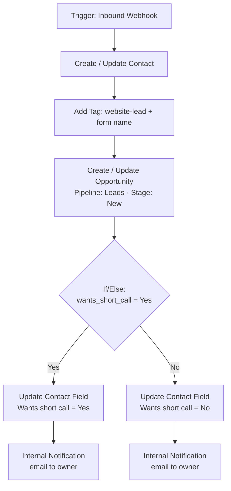

# GoHighLevel workflow pattern

This is the workflow the service forwards leads into. Build it in **Automation → Workflows → Create Workflow → Start from scratch**.



## 1. Trigger: Inbound Webhook

1. Add the **Inbound Webhook** trigger and copy its URL into `GHL_WEBHOOK_URL`. Keep it private.
2. Send one test lead through the service (see the README) so GHL captures a sample payload.
3. Click **Fetch sample requests** and select it. The fields (`email`, `first_name`, `wants_short_call`, ...) become available as `{{inboundWebhookRequest.<field>}}`.

## 2. Create Contact

Action **Create Contact** (or **Create/Update Contact** so repeat visitors don't create duplicates):

| GHL field | Value |
| --- | --- |
| First Name | `{{inboundWebhookRequest.first_name}}` |
| Last Name | `{{inboundWebhookRequest.last_name}}` |
| Email | `{{inboundWebhookRequest.email}}` |
| Phone | `{{inboundWebhookRequest.phone}}` |
| Website | `{{inboundWebhookRequest.website}}` |
| Source | `{{inboundWebhookRequest.form_name}}` |

## 3. Add Tags

Add `website-lead` plus a tag per form (for example `free-audit`). Tags let you build smart lists and trigger follow-up workflows later.

## 4. Create Opportunity

Action **Create/Update Opportunity**: choose your pipeline and the first stage (for example *New Lead*). Name it `{{contact.name}} – {{inboundWebhookRequest.form_name}}`.

## 5. If/Else for the checkbox

Create a custom contact field first (**Settings → Custom Fields**), for example *Wants short call* (single line or dropdown Yes/No).

The service already converts checkbox values to `Yes` / `No` (see `BOOLEAN_FIELDS`), so the condition is simple:

- **Branch "Yes":** `inboundWebhookRequest.wants_short_call` *is* `Yes` → **Update Contact Field** *Wants short call* = `Yes`
- **Else:** **Update Contact Field** *Wants short call* = `No`

> **Note:** If/Else branches in GHL do not merge back together. Put any step that should run for both branches (such as the notification below) inside **each** branch.

## 6. Internal Notification

In each branch add **Internal Notification → Email** to the owner, for example:

```
New lead: {{contact.name}}
Email: {{contact.email}}
Phone: {{contact.phone}}
Website: {{contact.website}}
Wants a short call: {{contact.wants_short_call}}
Form: {{inboundWebhookRequest.form_name}}
Message: {{inboundWebhookRequest.message}}
```

## Testing

1. Publish the workflow.
2. Post the sample payload (README → *Try it locally*), or submit the real form.
3. Check **Contacts**, **Opportunities** and the workflow's **Execution Logs**.

## Ideas to extend

- An instant reply email/SMS to the lead with a booking link
- A reminder if no appointment is booked within 24 hours
- Moving the opportunity to *Booked* when an appointment is created
